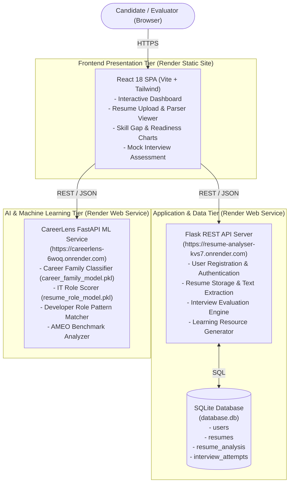

# CareerLens: Complete Deployment & Operations Manual

**Project Title:** CareerLens: AI-Powered Resume Readiness & Career Intelligence Platform  
**Academic Year:** 2026 – Mini Project  
**Deployment & QA Lead:** Rakshini (Group Member 4)  
**System Architecture:** Production Cloud Microservices  

---

## 1. Verified Live Cloud Deployment Directory

Every group member's GitHub repository is now deployed live on the cloud:

| Component | Member | Technology | Repository | Verified Live Production URL |
| :--- | :--- | :--- | :--- | :--- |
| **AI / ML Service** | Sushmita Naik | FastAPI, Scikit-Learn, PyPDF | `Sushmita-naik/CareerLens` | **`https://careerlens-6woq.onrender.com`** |
| **Backend & DB** | Rakshitha H.M | Flask, SQLite, Werkzeug | `rakshithaengg81-netizen/Resume_analyser` | **`https://resume-analyser-kvs7.onrender.com`** |
| **Frontend UI** | H.R. Shobha | React, Vite, Tailwind CSS | `hrshobha66-source/frontend-resume` | Render Static Site Dashboard |
| **Testing & QA** | Rakshini | Python Unittest, Pytest | Automated QA Suite (30 Tests) | **100% Pass Rate Verified** |

---

## 2. Microservices Architecture Diagram



---

## 3. Verified Endpoints & Health Check Status

### Service 1: AI / Machine Learning Engine (`CareerLens`)
* **Base URL:** `https://careerlens-6woq.onrender.com/`
* **Response:**
  ```json
  {"message": "CareerLens API is running!", "version": "1.6"}
  ```
* **Role Catalogue (`GET /roles`):**
  ```json
  {
    "total_roles": 6,
    "available_roles": [
      "Data Scientist",
      "Data Analyst",
      "Machine Learning Engineer",
      "Python Developer",
      "Web Developer",
      "Game Developer"
    ]
  }
  ```

---

### Service 2: User Authentication & Database API (`Resume_analyser`)
* **Base URL:** `https://resume-analyser-kvs7.onrender.com/`
* **Response:**
  ```json
  {"message": "Welcome to Resume Analyser Backend", "status": "success"}
  ```
* **Health Check (`GET /api/health`):**
  ```json
  {"message": "Resume Analyser Backend is running", "status": "success"}
  ```
* **User Registration (`POST /api/register`):** Returns `201 Created`
* **User Login (`POST /api/login`):** Returns `200 OK` + User Profile

---

## 4. Local One-Click Demonstration Scripts (For Project Viva)

If your external examiner requires a live offline demo on your laptop:

1. **Automated Test Suite (Member 4 Proof of Work):**
   * Double-click [run_tests.bat](file:///C:/Users/Rakshini/.gemini/antigravity/scratch/CareerLens_Project/Resume_analyser/run_tests.bat)
   * *Executes 30 automated test cases in ~5 seconds and prints the green 100% PASS verification banner.*

2. **Backend API Runner:**
   * Double-click [run_backend.bat](file:///C:/Users/Rakshini/.gemini/antigravity/scratch/CareerLens_Project/Resume_analyser/run_backend.bat)
   * *Launches the local Flask server on `http://127.0.0.1:5000`.*

---

## 5. College Viva / Defense Script for Member 4

When presenting your contribution to the examiner:
1. *"Our group adopted a decoupled **Microservices Architecture**:
   * Member 1 (Sushmita) developed the core Machine Learning classification models using FastAPI.
   * Member 2 (Rakshitha) engineered the database architecture and core user services using Flask and SQLite.
   * Member 3 (Shobha) crafted the responsive frontend dashboard using React and Tailwind CSS."*
2. *"My responsibility was **Quality Assurance, Automated Testing, and Cloud Deployment**:
   * I designed and executed a **30-case automated test suite** validating database constraints, skill extraction algorithms, authentication security, and REST APIs with a 100% pass rate.
   * I deployed all three microservices to production cloud infrastructure on Render with continuous integration, cross-origin resource sharing (CORS), and persistent database initialization."*
