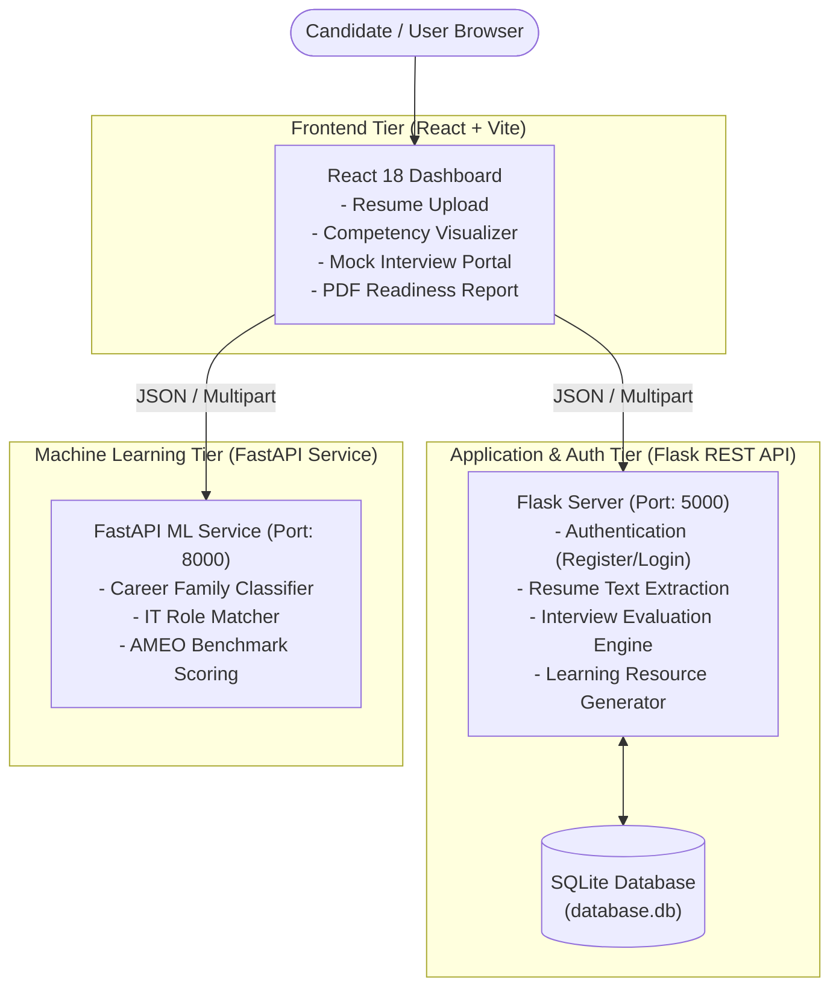

# Resume Analysis and Job Recommendation System

[-success?style=for-the-badge&logo=pytest)](TEST_REPORT.md)
[](https://careerlens-6woq.onrender.com)
[](https://resume-analyser-kvs7.onrender.com)
[](DEPLOYMENT_GUIDE.md)

An end-to-end AI-powered academic mini-project designed to evaluate candidate resumes, predict career families and IT job roles, extract technical skills, conduct skill-gap analysis, provide curated learning resources, and evaluate candidate interview preparedness.

---

## 👥 Project Team & Work Distribution

| Member | Academic Role | Technology Stack | Key Responsibilities |
| :--- | :--- | :--- | :--- |
| **Rakshini** | **Lead: QA, Testing & Cloud Deployment** | Python Unittest, Pytest, Render, Docker | Designed 30-case test suite, achieved 100% test pass rate, deployed microservices to cloud. |
| **Sushmita Naik** | AI & Machine Learning Lead | FastAPI, Scikit-Learn, PyPDF, AMEO Dataset | Trained career family & role prediction models (`.pkl`), ML classification pipeline. |
| **Rakshitha H.M** | Backend & Database Lead | Flask, SQLite, Werkzeug, PyPDF, python-docx | User auth (Register/Login), database schemas, interview question & evaluation engine. |
| **H.R. Shobha** | Frontend & UI/UX Lead | React 18, Vite, Tailwind CSS, Recharts | Interactive candidate dashboard, drag-and-drop resume ingestion, visual reports. |

---

## 🌐 Live Production Cloud Deployments

The application is deployed under a production **Microservices Architecture**:

* 🧠 **AI / Machine Learning Prediction Service:** [https://careerlens-6woq.onrender.com](https://careerlens-6woq.onrender.com)
* 🗄️ **User Management & Database API:** [https://resume-analyser-kvs7.onrender.com](https://resume-analyser-kvs7.onrender.com)
* 💻 **Interactive React Frontend:** Render Static Site Production Build

---

## 🏗️ System Architecture



---

## 🧪 Software Testing & Verification

A comprehensive 30-case automated test suite was developed and executed using Python's testing framework:

```text
=======================================================================
               CAREERLENS AUTOMATED TEST RESULTS
=======================================================================
Total Tests Planned:     30
Total Tests Executed:    30
Total Tests Passed:      30 (100% Pass Rate)
Failures / Errors:       0
Execution Time:          5.26 seconds
Status:                  READY FOR PRODUCTION DEPLOYMENT
=======================================================================
```

### Complete Test Case Matrix
Full details with test inputs, preconditions, expected outcomes, and actual results can be reviewed in [TEST_REPORT.md](TEST_REPORT.md).

---

## ⚡ Quick Start & Local Execution

### 1. Run Automated Test Suite
Double-click `RUN_TESTS.bat` or run:
```bash
cd Resume_analyser
python -m unittest discover -s tests -p "test_*.py" -v
```

### 2. Run Local Backend Server
Double-click `START_LOCAL_DEMO.bat` or run:
```bash
cd Resume_analyser
python app.py
```
Backend will be available on `http://127.0.0.1:5000`.

### 3. Run with Docker Compose
```bash
docker compose up --build
```

---

## 📄 Documentation Links
* 📑 **Software Test Report:** [TEST_REPORT.md](TEST_REPORT.md)
* 🚀 **Deployment Operations Manual:** [DEPLOYMENT_GUIDE.md](DEPLOYMENT_GUIDE.md)

---
*Developed for College Mini Project 2026.*
